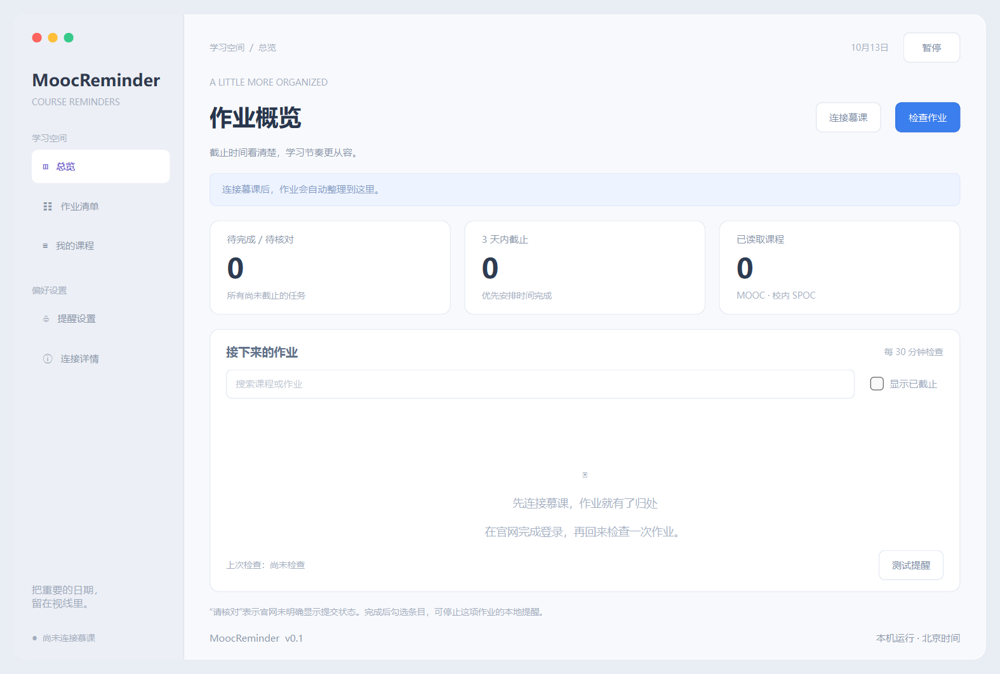

# MoocReminder v0.1.2

把 MOOC 作业的截止时间集中起来，在忘记提交之前提醒你。

## 为什么开发这个程序

我们也经常被忘交 MOOC 作业这件事困扰。

同时上几门课时，作业和测验分散在不同课程页面里，截止时间也各不相同。原本想着“过两天再做”，一忙起来就忘了；等到重新打开课程，才发现提交入口已经关闭。明明打算完成，却因为没记住截止时间错过了作业。

因此，我们开发了 **MoocReminder**：自动检查课程中的作业与测验，把截止时间整理到一个窗口，并在到期前提醒。希望少一些“怎么已经截止了”的懊恼，让大家更容易安排自己的学习时间。



## 目前能做什么

- **集中查看截止时间**：读取中国大学 MOOC 和校内 SPOC 的作业、测验，按截止时间整理。
- **定期检查与提前提醒**：默认每 30 分钟检查，提前 3 天、1 天、3 小时弹窗提醒。
- **按自己的节奏设置**：支持修改检查间隔、提醒时间、课程主页及补充作业链接。
- **记录完成情况**：支持搜索和本地完成标记，完成后可停止该项提醒。
- **保留已有记录**：单门课程读取失败时保留上次结果，登录配置按账号保存在本机。
- **直观的启动过程**：独立启动窗口显示当前阶段和进度，支持取消、失败重试，并自动创建桌面快捷方式。
- **解压即用**：内置 Python 运行环境与网页组件，换一台电脑无需安装 Python、.NET 或 WebView2。

主窗口采用 macOS 风格，程序运行在 Windows 上；通过内置的 QtWebEngine 窗口登录官网，登录窗口与后台检查共用本地配置。

## 未来希望扩充的方向

现在的提醒发生在电脑上。接下来，我们希望把提醒送到更常看的地方，并进一步打通任务处理流程。

- [ ] **微信提醒**：把即将到期的作业推送到微信，离开电脑后也能及时收到提醒。
- [ ] **邮箱提醒**：支持邮件通知和作业汇总，让截止时间进入日常查看的收件箱。
- [ ] **domooc 联动与自动完成**：探索接入 [domooc](https://domooc.top/domoocreadme)，将作业检测、截止提醒与自动完成流程衔接起来，并同步处理后的任务状态。

这些方向目前处于规划阶段，具体接入方式会逐步验证和完善。我们的长期目标是让“发现任务、收到提醒、及时处理、更新状态”形成连贯的流程，减少遗漏和重复操作。

## 快速开始

### 运行环境

- Windows 10 / 11，64 位。
- **不需要预先安装任何东西**：Python 运行环境与网页组件都随包分发（内置 CPython 与 QtWebEngine）。
  不再需要 .NET Desktop Runtime，也不再需要 WebView2 Runtime。

### 使用步骤

1. 下载 [v0.1.2 便携包](https://github.com/Dviodj/MoocReminder/releases/download/v0.1.2/MoocReminder-v0.1.2-offline-x64.zip)，**解压完整文件夹**（压缩包约 248 MB，解压后约 669 MB）。
2. 双击 **启动MoocReminder.bat**，启动窗口会显示进度，随后弹出登录窗。
3. 第一次使用点 **注册账号**，只填一个账号名称（例如「主账号」）即可进入。
4. 进入后点 **绑定慕课与邮箱**，填入课程主页链接 `https://www.icourse163.org/home.htm?userId=你的数字账号#/home/course` 和接收提醒的邮箱。这两步完成前无法检查作业。
5. 点击 **连接慕课**，在打开的官网窗口中登录。
6. 返回主窗口点击 **检查作业**，之后保持程序运行。

账号、慕课绑定与邮箱设置只需做一次，之后每次打开只需在登录窗选择账号进入。

最小化后仍会检查和提醒；关闭程序后停止监测，关机或休眠期间不会提醒。默认检查当前学期，历史学期可在设置中启用。

### 账号

启动时会先弹出登录窗，选择账号进入；没有账号就点 **注册账号**。

- **账号只存在这台电脑上**：不需要密码（账号名就是标识），也不会把任何数据上传到服务器。因此换一台电脑需要重新注册，作业记录不会同步。
- 每个账号各自绑定**自己的慕课账号、邮箱、作业列表与完成标记**，互不干扰；检查间隔、提前提醒小时数这类偏好由所有账号共用。
- 侧栏的 **当前账号** 可以随时切换账号，或选择「添加账号…」再建一个。切换后立即恢复该账号上次的内容，**不用重新登录慕课**。
- 新账号默认沿用当前账号的邮箱与授权码，不用重填；慕课绑定需要各自填写。

以后若要把账号放到服务器上（跨设备登录、关机也能收到提醒），账号数据层已经独立成 `profiles.py`，可以替换实现而不改界面。

### 邮件提醒

主界面右上角的 **邮件提醒** 按钮随时可点，**不需要先登录慕课**。填入接收提醒的邮箱、自动识别的服务器地址和邮箱授权码（不是登录密码），保存后可先发一封测试邮件确认。

提醒会发在两类时机：作业临近截止的提醒窗口（默认提前 72、24、3 小时），以及在「每日发信时刻」填写的固定时刻（例如 `08:00,20:00`）汇总一次。授权码加密后只保存在本机。**程序需要在运行**，关机、休眠或退出程序期间不会发信。

### 提示“无法验证发布者”时

这是 Windows 对**从网上下载的文件**的常规提示，不是病毒警告：发布包里的文件带着“来自网络”的标记，Windows 会先拦一次。**点“运行”即可**——启动脚本第一步就会自动清除整个文件夹的这个标记，之后再启动不再弹提示。

程序未做数字签名，所以这一次提示无法由程序自身避免。如不希望任何提示，需要为发布包购买代码签名证书。

官网未明确显示提交状态的条目会标为“请核对”。程序读取的是作业提交截止时间，互评截止时间不会列入提交提醒。

需要较小的下载或进行开发时，也可使用 [源码包](https://github.com/Dviodj/MoocReminder/releases/download/v0.1.2/MoocReminder-v0.1.2-source.zip)。源码包不含内置运行环境，需要机器上已有 64 位 Python 3.11–3.15，并由使用者自行安装依赖；便携包把这些都放在发布前完成。

## 本地数据与问题排查

设置、作业缓存和完成标记优先保存在 `%LOCALAPPDATA%/MoocDeadlineReminder`；该目录不可写时，使用项目内的 `data` 文件夹。登录配置保存在数据目录下的 `web-profiles/<账号>`。

个人登录配置和作业缓存不上传仓库，也不包含在发布包中。换电脑后需要重新登录。启动失败时可查看 `.launcher-state/startup.log`；读取失败时可在主窗口的 **连接详情** 查看错误。

发布包内置 CPython 与 Qt（含 QtWebEngine），随包组件的版本与来源记录在 `.build/runtime-bundle/bundle.json`，CPython 压缩包与各 wheel 的 SHA-256 在构建时校验。第三方许可证保留在各组件及 `.dist-info` 目录中；Qt 采用 LGPL-3.0，正文随包提供在 `licenses/`。该目录无需提交到 GitHub 源码仓库。

## 仓库结构

仓库根目录只放被版本控制的源码和发布入口；构建、发布与实测产物统一收在 `.build/` 下（该目录无需提交，可随时删除）：

| 路径 | 内容 |
| --- | --- |
| 根目录 `*.py` | 启动器、主界面、读取逻辑与打包脚本，全部扁平放置 |
| `assets/`、`docs/`、`tests/`、`web/` | 图标、验证记录与结构说明、自动测试、网页版界面资源 |
| `LICENSE`、`THIRD-PARTY-NOTICES.md`、`licenses/` | 本项目 MIT 许可证、随包第三方组件声明、Qt 的 LGPL/GPL 正文 |
| `.launcher-state/` | 本机启动日志与运行缓存，按已发布离线包的布局保留在根目录 |
| `.build/` | `runtime-bundle/`（解压好的运行组件）、`wheel-cache/`、`releases/`、`temp/`、`artifacts/` |

各文件的用途、当前运行链路，以及 `gui.py`、`qt_reader.py`、`web/` 等历史遗留文件的现状，见 [docs/STRUCTURE.md](docs/STRUCTURE.md)。

## 开发与验证

```powershell
python -m venv .venv
.\.venv\Scripts\python.exe -m pip install -r requirements.txt
.\.venv\Scripts\python.exe -m unittest discover -s tests -v
```

开发环境约 760 MB（QtWebEngine 占大部分）。`test_site` 与 `test_qt_reader` 会真实渲染页面，请在有图形界面的 Windows 会话运行，不需要联网。

当前开发状态为 **166 项通过**（`python -m unittest discover -s tests`）。复现完整数量需要 64 位 Python 3.11–3.15 并安装 `requirements.txt`：缺少 `PySide6-WebEngine` 时 `test_qt_reader` 与 `test_site` 会导入失败（该模块由 Qt 单独分发，不在 Essentials 或 Addons 内）。v0.1.1 发布时通过 83 项。

发布者制作便携包：先运行 `python bundle_runtime.py` 生成内置 Python 与 Qt 组件，再运行 `python package_source.py --with-runtime` 打出 ZIP。普通用户无需执行构建步骤。`qt_login_click_check.py` 用于人工验证真实的“连接慕课”按钮。

课程读取依赖官网当前页面结构。登录失效或网站结构变化时，程序会显示错误并保留缓存。

## 欢迎一起完善

如果你也被忘交 MOOC 作业困扰，欢迎试用并提出建议。遇到漏读课程、截止时间异常或提醒问题，可以通过 [Issues](https://github.com/Dviodj/MoocReminder/issues) 反馈；也欢迎贡献代码，帮助完善微信、邮件提醒和 domooc 联动。

## 许可证

本项目采用 [MIT 许可证](LICENSE)，你可以自由使用、修改和再发布，只需保留版权声明。

随附的第三方组件遵循各自的许可证：PySide6 与 shiboken6 采用 LGPL-3.0 / GPL-2.0 / GPL-3.0 三重许可，正文随包提供在 `licenses/`；随包分发的 CPython 采用 PSF 许可证。全部组件清单与位置见 [THIRD-PARTY-NOTICES.md](THIRD-PARTY-NOTICES.md)。
